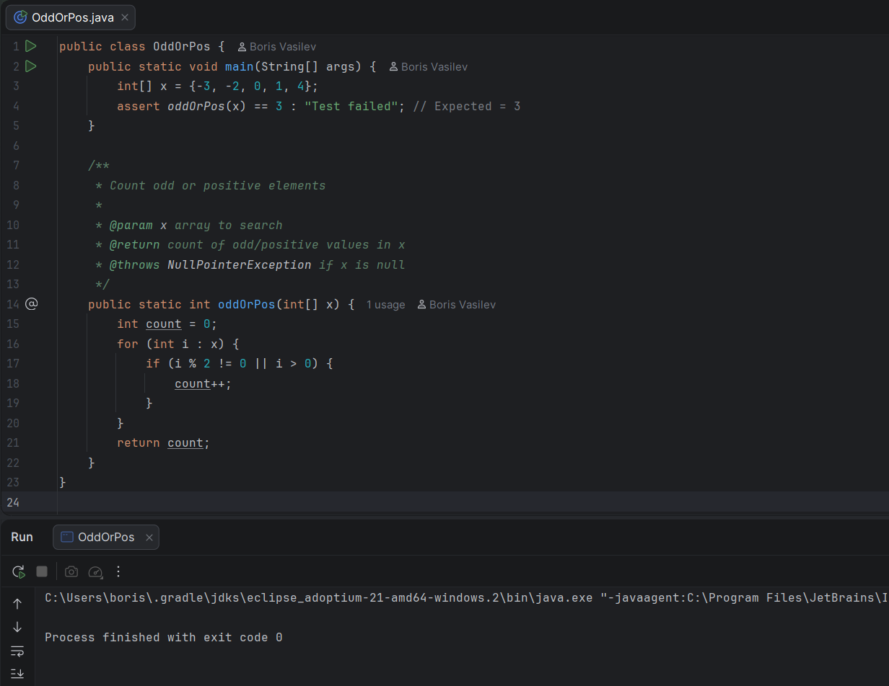

1.
    1. The code checks for `== 1`; however, negative odd numbers mod 2 return `-1`. This can be fixed by changing the
       expression to `x[i] % 2 != 0`
    2. An empty array being passed for `x` would not execute the fault, as the loop will never run
    3. The array `[0, 1, 4]` would execute the fault 3 times, but not result in an error state, as none of the numbers
       are both negative and odd
    4. There is no test case which results in an error but not a fault, as an error directly affects the return value,
       and there is no code after the faulty code to change this value further
    5. In the given test case, the first iteration of the loop results in an error state because `-3%2` is equal to
       `-1`, not `1`, and the counter is not incremented
    6. The assert statement doesn’t fail: 
